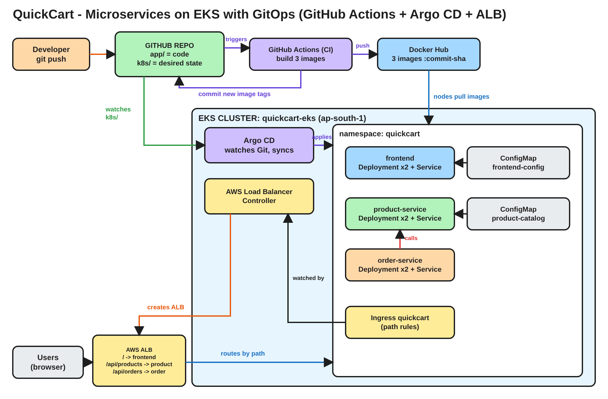

# QuickCart - Microservices on AWS EKS with GitOps and Argo CD

**One lab. One application. From an empty AWS account to a self-healing, auto-deploying microservices shop.**

**Written by Rahul Chaubey**

---

## A note from me before you start

Hello, and welcome.

I wrote this runbook so you can build the whole lab on your own, from zero, without getting stuck. Every step has the same four parts:

| Part | What it gives you |
|---|---|
| **Context** | Where we are in the story, and why this step exists |
| **Concept** | The idea behind the step, in plain words |
| **Lab** | The exact commands and clicks, with what you should see |
| **Interview Question** | A real interview question on this step, with a short answer |

Please do not just copy and paste. Read the Context and the Concept first. When you see **Think about it**, try to answer in your head before you read on. That small pause is where the real learning happens.

Every command is written for **Git Bash on Windows**, and it works the same on macOS and Linux.

---

## The problem we are solving

A developer changes one line of code and pushes it. Ten minutes later the change is live on a real AWS load balancer, in front of real users.

Nobody ran `kubectl`. Nobody logged in to the cluster. Nobody clicked "deploy".

How?

By the end of this lab you will have built exactly that, end to end, and you will be able to explain every piece of it in an interview.

---

## What we are building

**QuickCart** is a tiny online shop. You open it in a browser, see products with prices, pick a quantity, and place an order. Everyone already knows how a shop works, so all your attention can go to **how it is built, shipped and run**.



### The 3 microservices

| Microservice | What it does | Technology | Port |
|---|---|---|---|
| frontend | The web page users see | nginx | 8080 |
| product-service | Lists products and prices (`GET /api/products`) | Python FastAPI | 8000 |
| order-service | Takes an order, asks product-service for the real price (`POST /api/orders`) | Python FastAPI | 8000 |

### How one request travels

```text
 Browser
    |
    v
 AWS Application Load Balancer (one public URL, the front door)
    |
    |-- /               ---> frontend
    |-- /api/products   ---> product-service
    |-- /api/orders     ---> order-service
                                 |
                                 |  inside the cluster, no ALB
                                 v
                            product-service  (http://product-service)
```

The ALB only handles traffic from **outside**. When order-service needs a price, it calls product-service **directly inside the cluster**, using the Kubernetes Service name.

### The 10 Kubernetes objects

| Object | How many | Names | Job |
|---|---|---|---|
| Namespace | 1 | quickcart | Keeps everything together |
| Deployment | 3 | frontend, product-service, order-service | Runs the pods, 2 per service |
| Service | 3 | frontend, product-service, order-service | A stable internal name and IP for each microservice |
| Ingress | 1 | quickcart | The path rules that become a real AWS ALB |
| ConfigMap | 2 | frontend-config, product-catalog | The banner and the prices, kept outside the code |

### What is in this repository

| Folder | What is inside | Who uses it |
|---|---|---|
| `app/` | Code of the 3 services, a Dockerfile each, unit tests | The CI pipeline builds images from it |
| `.github/workflows/` | `ci.yaml`, the pipeline | GitHub Actions |
| `k8s/` | The 10 Kubernetes objects (the desired state) | Argo CD deploys it |
| `argocd/` | The Argo CD Application (a pointer to `k8s/`) | You, applied once |
| `cluster/` | `eks-cluster.yaml` | eksctl, once |
| `diagrams/` | Architecture diagram | You |

### The whole flow in one picture

```text
 YOU            GITHUB ACTIONS (CI)              GIT                     ARGO CD (CD)       EKS
 git push  -->  test -> build -> push      -->   k8s/*.yaml        <--   watches Git  -->   pods updated
                to Docker Hub                    new image tags          applies changes    ALB serves users
                commit new tags to Git
```

Two rules make this work, and you will see both in action:

1. **CI builds, CD deploys.** The pipeline never touches the cluster.
2. **Git is the single source of truth.** The cluster always ends up looking exactly like the `k8s/` folder.

### The steps

| Step | What you do |
|---|---|
| 0 | Only if you did this lab before: reset to a fresh start |
| 1 | Tools and accounts |
| 2 | Create the EKS cluster (it takes 20 minutes, so we start it early) |
| 3 | Create your GitHub repository and add the secrets |
| 4 | Push the code and watch CI run |
| 5 | Install the AWS Load Balancer Controller |
| 6 | Install Argo CD |
| 7 | Open the Argo CD UI |
| 8 | Create the Application and sync it by hand |
| 9 | Open the shop through the ALB |
| 10 | Switch on automation |
| 11 | Break it on purpose and watch it heal |
| 12 | The full loop: change code, push, watch it go live |
| 13 | Change a price through Git, with no rebuild |
| 14 | Roll back with git revert |
| 15 | Clean up, in the right order |

---

## Step 0 - Only if you have done this lab before: reset to a fresh start

### Context

Skip this step if this is your first time.

If you already ran this lab with your own `quickcart-gitops-yt` repository, it still holds the changes you made last time: version 1.1.0, the Rs. 249 price, the sale banner, and maybe a running cluster. Steps 12 and 13 expect a fresh starting point, so we put everything back first. You do **not** need to delete or recreate the repository.

### Concept

In GitOps, a fresh start is just another Git commit. We change the files back to their starting values, push once, and the pipeline rebuilds clean 1.0.0 images.

### Lab

**0.1 Make sure nothing is still running in AWS.** If your cluster from last time still exists, do **Step 15** first.

```bash
eksctl get cluster --region ap-south-1
```

**Expected:** `No clusters found`.

**0.2 Reset the files.** In your repository folder:

```bash
cd <your>/quickcart-gitops-yt
git pull origin main
sed -i -E 's/APP_VERSION = "[0-9.]+"/APP_VERSION = "1.0.0"/' app/product-service/main.py app/order-service/main.py
sed -i -E 's/const FRONTEND_VERSION = "[0-9.]+"/const FRONTEND_VERSION = "1.0.0"/' app/frontend/index.html
sed -i -E 's/("Kubernetes Mug", "price": )[0-9]+/\1299/' k8s/20-product-service.yaml
sed -i -E 's/"banner": ".*"/"banner": "Welcome to QuickCart - deployed by Argo CD"/' k8s/10-frontend.yaml
git diff
```

**Expected:** `git diff` shows only the lines that are going back to their starting values. If it shows nothing, your repository is already fresh.

**0.3 Push the fresh start:**

```bash
git add .
git commit -m "Reset to a fresh starting state"
git push origin main
```

The push changes `app/`, so the pipeline runs and builds fresh images. Wait for it to turn green in the **Actions** tab, then run `git pull origin main` to get the bot's commit.

Now continue from **Step 2**. You already have the tools, the accounts, the repository and the secrets, so you can skip Step 1 and Step 3, and in Step 2 use your existing folder instead of downloading the ZIP.

---

## Step 1 - Tools and accounts

### Context

Before we touch AWS, your laptop needs five tools, and you need three accounts. Most problems in a lab like this are not about GitOps at all. A tool is missing, or AWS credentials are wrong. We fix all of that now.

### Concept

| Tool | Why you need it |
|---|---|
| git | Every change in GitOps is a Git commit |
| AWS CLI v2 | Talks to your AWS account |
| eksctl | Creates and deletes the EKS cluster with one command |
| kubectl | Talks to the Kubernetes cluster |
| helm | Installs the AWS Load Balancer Controller |

| Account | Why you need it |
|---|---|
| AWS | The EKS cluster and the ALB run here |
| GitHub | Your code lives here, and GitHub Actions is your CI |
| Docker Hub | Your container images are stored here |

### Lab

**1.1 Install Git for Windows** (this gives you Git Bash). In PowerShell:

```powershell
winget install -e --id Git.Git
winget install -e --id Amazon.AWSCLI
winget install -e --id Kubernetes.kubectl
winget install -e --id Helm.Helm
```

On macOS: `brew install git awscli kubectl eksctl helm`, then skip to 1.3.

**1.2 Install eksctl.** Close PowerShell, open **Git Bash**, and run:

```bash
mkdir -p ~/bin && cd ~/bin
curl -sLO https://github.com/eksctl-io/eksctl/releases/latest/download/eksctl_Windows_amd64.zip
unzip -o eksctl_Windows_amd64.zip && rm eksctl_Windows_amd64.zip
echo 'export PATH="$HOME/bin:$PATH"' >> ~/.bashrc
source ~/.bashrc
cd ~
```

If Git Bash says `unzip: command not found`, replace the unzip line with:

```bash
powershell -Command "Expand-Archive -Force eksctl_Windows_amd64.zip ."
```

**1.3 Check every tool.** Close and reopen Git Bash, then:

```bash
git --version
aws --version
kubectl version --client
eksctl version
helm version
```

**Expected:** all five print a version.

**1.4 AWS access.** Use a personal or learning AWS account, never a company production account.

1. In the AWS Console open **Billing and Cost Management**, then **Budgets**, and create a **Monthly cost budget** with your email. Do this first. EKS charges every hour.
2. Open **IAM**, then **Users**, then **Create user**. Name it `gitops-lab-admin`, and attach **AdministratorAccess**.
3. Open the user, then **Security credentials**, then **Create access key**, choose **Command Line Interface**, and copy both keys.

```bash
aws configure
```

| Prompt | Value |
|---|---|
| AWS Access Key ID | your key |
| AWS Secret Access Key | your secret |
| Default region name | ap-south-1 |
| Default output format | json |

```bash
aws sts get-caller-identity
```

**Expected:** your account number and an ARN ending in `user/gitops-lab-admin`.

**1.5 GitHub and Docker Hub.** Make sure you can log in to both, and note your usernames. Set your Git identity once:

```bash
git config --global user.name  "Your Name"
git config --global user.email "you@example.com"
```

**Concept: Why AdministratorAccess?**
eksctl creates a VPC, subnets, IAM roles, EC2 nodes and CloudFormation stacks. Giving exact minimum permissions for all of that is a lesson of its own. In a personal lab account, admin access keeps you focused. In a company, you would get a role with only what you need. Never commit these keys to Git.

### Interview Question

**Q: Why should a lab or test environment always have a budget alert?**

A: Cloud resources such as EKS, EC2 nodes and load balancers are billed every hour whether you use them or not. A budget alert emails you when spending crosses a limit, so a forgotten cluster becomes a small cost, not a big surprise.

---

## Step 2 - Create the EKS cluster

### Context

Creating an EKS cluster takes about 20 minutes. So we start it now, and while AWS builds it, we do Steps 3 and 4 in another Git Bash window. Those steps do not need the cluster.

### Concept

You will create a whole Kubernetes cluster with one command and one file. Behind that command, eksctl uses AWS CloudFormation to build a VPC, subnets, IAM roles, the EKS control plane and two worker nodes.

The file also creates something we need later: an IAM role for the **AWS Load Balancer Controller**, linked to a Kubernetes service account. This is called **IRSA** (IAM Roles for Service Accounts). It lets one pod get AWS permissions without any access keys.

### Lab

**2.1 Get the code.** Open https://github.com/discover-devops/quickcart-gitops-yt, click the green **Code** button, then **Download ZIP**. Extract it. You get a folder called `quickcart-gitops-yt-main`. Rename it to `quickcart-gitops-yt`.

In Git Bash, go into it (change the path to where you extracted it):

```bash
cd /c/Users/<you>/Downloads/quickcart-gitops-yt
ls -la
```

**Expected:** you see `.github`, `app`, `argocd`, `cluster`, `diagrams`, `k8s` and `README.md`.

The `.github` folder starts with a dot, so it is hidden by default. Make sure it is there. Without it, there is no pipeline.

**2.2 Read the cluster file:**

```bash
cat cluster/eks-cluster.yaml
```

| Setting | Meaning |
|---|---|
| name: quickcart-eks | The cluster name |
| region: ap-south-1 | Mumbai |
| withOIDC: true | Lets service accounts use IAM roles (IRSA) |
| serviceAccounts: aws-load-balancer-controller | The IAM role the ALB controller will use in Step 5 |
| 2 x t3.medium | Two worker nodes |

**2.3 Create the cluster:**

```bash
eksctl create cluster -f cluster/eks-cluster.yaml
```

Leave this window running. Open **CloudFormation** in the AWS Console, region Mumbai, to watch the stacks being built.

**Open a second Git Bash window and go on to Step 3.** Come back here when eksctl finishes.

**2.4 When eksctl finishes:**

```bash
kubectl get nodes
```

**Expected:**

```text
NAME                                            STATUS   ROLES    AGE   VERSION
ip-192-168-xx-xxx.ap-south-1.compute.internal   Ready    <none>   3m    v1.3x
ip-192-168-xx-xxx.ap-south-1.compute.internal   Ready    <none>   3m    v1.3x
```

**Concept: Cattle, not pets**
The cluster is defined in a file, so you can delete it after every session and create the exact same cluster next time. Nothing important lives only inside it. The application lives in Git.

### Interview Question

**Q: What is IRSA, and why is it better than putting AWS access keys in a pod?**

A: IAM Roles for Service Accounts. A Kubernetes service account is linked to an IAM role, and pods using that service account get short-lived AWS credentials automatically. There are no long-lived keys to leak or rotate, and each pod gets only the permissions it needs.

---

## Step 3 - Create your GitHub repository and add the secrets

### Context

In GitOps, Git controls the cluster. So you need **your own** repository that you can push to. In this step you create an empty repository and prepare it before the first push, because the first push will start the pipeline straight away.

### Concept

The pipeline must log in to Docker Hub to push images. The password must never be in the code. GitHub **secrets** solve this. You store them once in the repository settings. GitHub hands them to the pipeline at run time and hides them in every log.

**Think about it:** if you forked a repository that had secrets, should the secrets come with the fork?

**Answer:** No. If secrets were copied to forks, anyone could fork a repository and steal its passwords. That is why everyone adds their own.

### Lab

**3.1 Create the empty repository.** On GitHub click **New repository**.

| Field | Value |
|---|---|
| Repository name | quickcart-gitops-yt |
| Visibility | **Public** (Argo CD reads it without a password) |
| Add a README / .gitignore / license | **Leave all unticked** |

Click **Create repository**. An empty repository has no Settings tabs in some views, but the settings pages still work through these links.

**3.2 Create a Docker Hub access token.** On https://hub.docker.com click your profile picture, then **Account settings**, then **Personal access tokens**, then **Generate new token**. Description `quickcart-ci`, permissions **Read & Write**. Copy the token. You will see it only once.

**3.3 Add two secrets.** Open this link, with your username in it:

```text
https://github.com/<your-github-username>/quickcart-gitops-yt/settings/secrets/actions
```

Stay on the **Secrets** tab (not Variables) and click **New repository secret** twice:

| Name | Value |
|---|---|
| DOCKERHUB_USERNAME | your Docker Hub username |
| DOCKERHUB_TOKEN | the token from 3.2 |

Type the names exactly. The pipeline looks them up by these names.

**3.4 Allow the pipeline to write to the repository.** Open:

```text
https://github.com/<your-github-username>/quickcart-gitops-yt/settings/actions
```

Scroll down to **Workflow permissions**, choose **Read and write permissions**, and click **Save**.

**Concept: Why does CI need write access?**
At the end, the pipeline commits the new image tags back into `k8s/`. That commit is how Argo CD learns there is a new version. Without write access, that last step fails with a 403 error.

**3.5 Point Argo CD at your repository.** The two files in `argocd/` contain my GitHub username. Replace it with yours:

```bash
export GH_USER=<your-github-username>
sed -i "s#github.com/discover-devops/#github.com/$GH_USER/#" argocd/quickcart-app.yaml argocd/quickcart-app-auto.yaml
grep repoURL argocd/*.yaml
```

**Expected:** both lines show `https://github.com/<your-github-username>/quickcart-gitops-yt.git`.

You do not need to change the image names in `k8s/`. The pipeline replaces them with your Docker Hub username on its first run.

### Interview Question

**Q: Where should a CI pipeline get its registry password from, and why not from the code?**

A: From the CI system's secret store, such as GitHub Actions secrets. Secrets in code end up in Git history forever, visible to anyone who can read the repository. A secret store injects them only at run time and masks them in logs.

---

## Step 4 - Push the code and watch CI run

### Context

Your code is on your laptop. GitHub Actions and Argo CD cannot see your laptop. They only read GitHub. So the first real step is always: put the code on GitHub. That push also starts the CI pipeline.

### Concept

CI means: **prove the code works, then package it.** Our pipeline has three jobs, and each one runs only if the previous one passed:

| Job | What it does |
|---|---|
| test | Runs the unit tests in `app/*/test_main.py`. If one fails, the pipeline stops and nothing is built |
| build | Builds the 3 images and pushes them to Docker Hub, tagged with the **Git commit ID** |
| update-manifests | Writes those new tags into `k8s/*.yaml` and commits them back to Git |

**Think about it:** why tag an image with the commit ID instead of `latest`?

**Answer:** `latest` tells you nothing. A commit ID tells you exactly which code is running in production, and lets you go back to it.

**Concept: CI stops at Git**
The pipeline never touches the cluster. It has no kubeconfig and no AWS keys. Its job ends when the new image tag is written into Git.

### Lab

**4.1 Push the code.** From inside your `quickcart-gitops-yt` folder:

```bash
git init -b main
git config core.autocrlf input
git add .
git commit -m "QuickCart GitOps lab"
git remote add origin https://github.com/$GH_USER/quickcart-gitops-yt.git
git push -u origin main
```

A browser window asks you to sign in to GitHub the first time.

If you have two GitHub accounts and the push fails with **403 Permission denied to other-account**, point Git at the right account and push again:

```bash
git remote set-url origin https://$GH_USER@github.com/$GH_USER/quickcart-gitops-yt.git
git push -u origin main
```

**4.2 Watch the pipeline.** Open the **Actions** tab of your repository. **CI - build and release** is already running.

**Expected** after about 3 to 4 minutes, all green:

```text
Matrix: test     2 jobs completed
Matrix: build    3 jobs completed
update-manifests
```

Click into a test job and look at the `pytest -v` output: 4 tests per service.

**4.3 Check Docker Hub.** You now have three repositories: `quickcart-frontend`, `quickcart-product-service` and `quickcart-order-service`. Open each one and make sure it is **Public**, otherwise the cluster cannot pull it.

**4.4 Pull the bot's commit:**

```bash
git pull origin main
git log --oneline -3
grep -n "image:" k8s/*.yaml
```

**Expected:** a commit from the bot called `ci: release images ...`, and every image line now has your Docker Hub username and a long commit ID:

```text
k8s/10-frontend.yaml:44:          image: <you>/quickcart-frontend:3f9a2c1...
k8s/20-product-service.yaml:45:   image: <you>/quickcart-product-service:3f9a2c1...
k8s/30-order-service.yaml:26:     image: <you>/quickcart-order-service:3f9a2c1...
```

**Always run `git pull` before you push again.** The bot adds commits to your repository, and your next push is rejected until you have them.

### Interview Question

**Q: What is the difference between CI and CD? Where does CI stop in GitOps?**

A: CI tests the code and builds it into an image. CD deploys it. In GitOps, CI stops after updating the image tag in Git. The CD tool, Argo CD here, picks up that Git change and deploys it. CI never has access to the cluster.

---

## Step 5 - Install the AWS Load Balancer Controller

### Context

Go back to the window from Step 2 and make sure `kubectl get nodes` shows 2 nodes `Ready`. Our `k8s/40-ingress.yaml` asks for an ALB. But Kubernetes knows nothing about AWS.

### Concept

**Think about it:** who actually creates the ALB?

**Answer:** The **AWS Load Balancer Controller**. It runs inside the cluster, watches Ingress objects, and calls AWS to create the ALB with the right rules and health checks. Without it, our Ingress would just sit there and nothing would happen.

```text
 Ingress (k8s/40-ingress.yaml) --watched by--> Load Balancer Controller --creates--> AWS ALB
                                                        ^
                                       IAM role via IRSA (made by eksctl in Step 2)
```

### Lab

**5.1 Show the IAM role that eksctl linked to the controller's service account:**

```bash
kubectl get serviceaccount aws-load-balancer-controller -n kube-system -o yaml | grep role-arn
```

**Expected:** a line with `eks.amazonaws.com/role-arn: arn:aws:iam::...`. That one annotation is how the controller gets AWS permissions, with no keys.

**5.2 Install it with Helm:**

```bash
helm repo add eks https://aws.github.io/eks-charts
helm repo update eks

VPC_ID=$(aws eks describe-cluster --name quickcart-eks --region ap-south-1 --query "cluster.resourcesVpcConfig.vpcId" --output text)
echo $VPC_ID

helm install aws-load-balancer-controller eks/aws-load-balancer-controller -n kube-system --set clusterName=quickcart-eks --set serviceAccount.create=false --set serviceAccount.name=aws-load-balancer-controller --set region=ap-south-1 --set vpcId=$VPC_ID
```

**5.3 Check it:**

```bash
kubectl rollout status deployment aws-load-balancer-controller -n kube-system
kubectl get ingressclass
```

**Expected:**

```text
deployment "aws-load-balancer-controller" successfully rolled out
NAME   CONTROLLER            PARAMETERS   AGE
alb    ingress.k8s.aws/alb   <none>       20s
```

### Interview Question

**Q: You apply an Ingress on EKS and nothing happens. No ADDRESS appears. What do you check?**

A: First, whether the AWS Load Balancer Controller is installed and running in kube-system. Then its logs for AWS permission errors, which usually point to a missing or wrong IAM role on its service account. Then that the Ingress uses `ingressClassName: alb`.

---

## Step 6 - Install Argo CD

### Context

The images are on Docker Hub. Git says which images should run. The cluster can now create ALBs. Something still has to put our 10 objects into the cluster, and keep them there.

### Concept

**Think about it:** why not just add `kubectl apply -f k8s/` at the end of the CI pipeline?

**Answer:** Two problems. GitHub would need the keys to your production cluster, so anyone who can edit the workflow could change production. And once the pipeline finishes, nobody watches the cluster. If someone changes something by hand, nobody notices.

```text
 Push model (old):    CI pipeline --kubectl apply--> cluster      (the pipeline holds the cluster keys)
 Pull model (GitOps): Git <--watches-- Argo CD (inside cluster)   (the keys never leave the cluster)
```

**Argo CD** runs inside the cluster, pulls from Git, and keeps the cluster matching Git, all the time. Three of its pods matter today:

| Pod | Its job |
|---|---|
| argocd-repo-server | Reads your Git repository |
| argocd-application-controller | Compares Git with the cluster, and applies the difference |
| argocd-server | The UI and API |

The others are redis (a cache), dex (single sign-on), notifications (alerts) and applicationset (creating many Applications at once). We do not use them today.

### Lab

```bash
kubectl create namespace argocd
kubectl apply -n argocd --server-side --force-conflicts -f https://raw.githubusercontent.com/argoproj/argo-cd/stable/manifests/install.yaml
kubectl wait --for=condition=Available deployment --all -n argocd --timeout=300s
kubectl get pods -n argocd
```

We use `--server-side` because some Argo CD definitions are too large for a normal `kubectl apply`.

**Expected:** 7 pods, all `Running`:

```text
argocd-application-controller-0                     1/1     Running
argocd-applicationset-controller-xxxxxxxxx-xxxxx    1/1     Running
argocd-dex-server-xxxxxxxxx-xxxxx                   1/1     Running
argocd-notifications-controller-xxxxxxxxx-xxxxx     1/1     Running
argocd-redis-xxxxxxxxx-xxxxx                        1/1     Running
argocd-repo-server-xxxxxxxxx-xxxxx                  1/1     Running
argocd-server-xxxxxxxxx-xxxxx                       1/1     Running
```

### Interview Question

**Q: Which Argo CD component actually applies changes to the cluster? And why is the pull model safer than push?**

A: The application-controller. The repo-server only reads and renders the Git files, and argocd-server is the UI and API. Pull is safer because Argo CD runs inside the cluster, so the cluster credentials never leave it, and it keeps watching for drift instead of deploying once and walking away.

---

## Step 7 - Open the Argo CD UI

### Context

Argo CD is running, but it is not exposed to the internet. That is on purpose. We reach the UI through a secure tunnel from our laptop.

### Concept

`kubectl port-forward` opens a tunnel from a port on your laptop to a Service inside the cluster. It only works while the command is running. In real companies, the Argo CD UI sits behind an Ingress with single sign-on.

### Lab

**7.1** Open a **new Git Bash window** and leave this running:

```bash
kubectl port-forward svc/argocd-server -n argocd 8080:443
```

**7.2** In your main window, get the initial admin password:

```bash
kubectl -n argocd get secret argocd-initial-admin-secret -o jsonpath="{.data.password}" | base64 -d; echo
```

**7.3** Open https://localhost:8080. Click **Advanced**, then **Proceed** (the certificate is self-signed). Log in as `admin` with that password.

**Expected:** an empty **Applications** page.

If the page stops loading later, for example after a break or the next day, the port-forward has stopped. Run 7.1 again.

### Interview Question

**Q: How would you expose the Argo CD UI safely in a real company?**

A: Through an Ingress with TLS and single sign-on, for example dex connected to the company identity provider, and with Argo CD RBAC so each team sees only its own applications. Never as a public service with the default admin password.

---

## Step 8 - Create the Application and sync it by hand

### Context

Argo CD is installed, but it does not know what to deploy. We tell it with an **Application**.

### Concept

An Argo CD **Application** is a pointer. It does not contain your app. It says: "the `k8s` folder of this Git repository, on the `main` branch, should be running in the `quickcart` namespace of this cluster."

| Part of the file | Meaning |
|---|---|
| `source.repoURL` | Which Git repository |
| `source.targetRevision: main` | Which branch |
| `source.path: k8s` | Which folder |
| `destination.server` | Which cluster (`kubernetes.default.svc` means this one) |
| `destination.namespace` | Which namespace |
| `syncPolicy: {}` | Empty means **Manual**: show me the difference, and wait for me |

You can create the same Application by clicking **+ NEW APP** in the UI. We use a file instead, so even Argo CD's own setup lives in Git and can be reviewed and re-applied.

**Concept: The finalizer**
The file has `finalizers: resources-finalizer.argocd.argoproj.io`. It means: when this Application is deleted, first delete everything it deployed. Without it, deleting the Application leaves all the pods and the ALB running. We rely on it in Step 15.

### Lab

**8.1 Read the file, then apply it:**

```bash
cat argocd/quickcart-app.yaml
kubectl apply -f argocd/quickcart-app.yaml
```

**Expected:** `application.argoproj.io/quickcart created`. You may also see a warning about the finalizer name. It is only a naming suggestion and is harmless.

**8.2 Check the cluster:**

```bash
kubectl get all,configmap,ingress -n quickcart
```

**Expected:** `No resources found in quickcart namespace.`

**Think about it:** the Application exists. Why is nothing deployed?

**Answer:** The sync policy is Manual. Argo CD has read Git, but it waits for a human to approve.

**8.3 Look at it in the UI.** On the Applications page, the `quickcart` card shows **OutOfSync** and **Missing**.

**Concept: Desired state vs live state**
Argo CD always compares two things. The **desired state** is what Git says should exist. The **live state** is what is actually running. Git says 10 objects, the cluster has none. They disagree, and that is all OutOfSync means. It is information, not an error.

**8.4 Review, then sync:**

1. Click the **quickcart** card to open the app.
2. In the row of buttons at the top, click **DIFF**. You see every object Argo CD is about to create.
3. Click **SYNC**. A panel slides in from the right. Click **SYNCHRONIZE** at the top of that panel.
4. Watch the resource tree grow: Namespace, ConfigMaps, Deployments, Services and Ingress, then ReplicaSets, then pods.

**8.5 Check from the terminal:**

```bash
kubectl get all,configmap,ingress -n quickcart
```

**Expected:** 6 pods `Running` (2 per service), 3 Services of type `ClusterIP`, 3 Deployments `2/2`, the ConfigMaps `frontend-config` and `product-catalog`, and an Ingress with an **ADDRESS** like `quickcart-alb-123456789.ap-south-1.elb.amazonaws.com`.

You also see a ConfigMap called `kube-root-ca.crt`. Kubernetes creates it in every namespace. It is not ours.

The app shows **Synced**. It may show **Progressing** for 2 to 3 minutes while AWS builds the ALB.

### Interview Question

**Q: What does OutOfSync mean in Argo CD? Is it an error?**

A: It means the live state in the cluster differs from the desired state in Git. It is not an error. With manual sync, a person reviews the diff and decides when to sync. With automated sync, Argo CD syncs it by itself.

---

## Step 9 - Open the shop through the ALB

### Context

All 10 objects are running. Now we open the shop the way a real user would: through the public ALB.

### Concept

Nobody clicked anything in the AWS Console. You wrote an Ingress, Argo CD applied it, and the Load Balancer Controller built a real ALB with path rules and health checks.

Our Ingress uses `target-type: ip`. The ALB sends traffic straight to the pod IPs, so the Services can stay `ClusterIP`, internal only.

### Lab

**9.1 Get the ALB address:**

```bash
kubectl get ingress quickcart -n quickcart
```

Open `http://<ADDRESS>` in your browser, with `http`, not `https`. If you get an error, wait 2 to 3 minutes and reload. AWS needs a moment to register the pods.

**9.2 Use the shop:**

- The **banner** comes from the `frontend-config` ConfigMap.
- The **4 products and prices** come from the `product-catalog` ConfigMap.
- Pick a quantity and click **Order**. The confirmation shows which order-service pod handled it.
- The **footer** shows the version and pod of each microservice. Reload a few times and watch the product-service pod name change. The Service spreads requests across 2 pods.

**9.3 Test path routing from the terminal:**

```bash
ALB=$(kubectl get ingress quickcart -n quickcart -o jsonpath='{.status.loadBalancer.ingress[0].hostname}')
curl -s http://$ALB/api/products; echo
curl -s -X POST http://$ALB/api/orders -H "Content-Type: application/json" -d '{"product_id":2,"quantity":3}'; echo
```

Same URL, different paths, different services.

**9.4 See it in AWS.** Open **EC2**, then **Load Balancers**, then `quickcart-alb`, then the **Listeners** tab. Open the HTTP:80 rules: `/api/products*`, `/api/orders*`, and the default rule to the frontend. These are exactly the paths in `k8s/40-ingress.yaml`.

### Interview Question

**Q: What is the difference between ALB target type `instance` and `ip`?**

A: With `instance`, the ALB sends traffic to a NodePort on each node, and kube-proxy forwards it to a pod, which is an extra hop. With `ip`, the ALB sends traffic straight to the pod IPs. `ip` needs the AWS VPC CNI, which EKS uses by default, and lets Services stay ClusterIP.

---

## Step 10 - Switch on automation

### Context

Right now Argo CD only reports differences. Clicking SYNC for every change does not scale. In this step you see the difference between Manual and automated, with your own eyes.

### Concept

`argocd/quickcart-app-auto.yaml` is the **same Application**, with three switches turned on:

```yaml
  syncPolicy:
    automated:
      selfHeal: true
      prune: true
```

| Switch | Reacts to | What it does |
|---|---|---|
| automated | A change in **Git** | Syncs it without waiting for a click |
| selfHeal | A manual change in the **cluster** | Puts it back to what Git says, within seconds |
| prune | A file **removed** from Git | Deletes that object from the cluster |

**Think about it:** why is prune off unless you switch it on?

**Answer:** Deleting is dangerous. If someone deletes a file from Git by mistake, you do not want production to disappear automatically unless you have decided that is the behaviour you want.

### Lab

**10.1 Before: drift in Manual mode.** Change the cluster by hand:

```bash
kubectl scale deployment product-service -n quickcart --replicas=1
```

In the UI the app turns **OutOfSync**. Click the `product-service` Deployment box, then **DIFF**: Git says 2, the cluster says 1.

Wait 30 seconds, then:

```bash
kubectl get deployment product-service -n quickcart
```

**Expected:** still `1/1`. Manual mode **sees** drift, but does nothing about it.

**10.2 Switch on automation:**

```bash
diff argocd/quickcart-app.yaml argocd/quickcart-app-auto.yaml
kubectl apply -f argocd/quickcart-app-auto.yaml
```

**10.3 After:**

```bash
kubectl get pods -n quickcart
```

**Expected:** product-service is back to 2 pods. One of them is only a few seconds old. Nobody clicked SYNC.

In the UI, click **DETAILS**. **SYNC POLICY** shows **Automated**, with **Self Heal** and **Prune** enabled.

### Interview Question

**Q: Automated sync is on, but selfHeal is off. Someone runs `kubectl scale`. What happens?**

A: Nothing. The app shows OutOfSync and stays drifted. Automated sync only reacts to changes in Git. selfHeal is the switch that reverts manual changes in the cluster.

---

## Step 11 - Break it on purpose and watch it heal

### Context

Now you play the person who changes production by hand, "just this once". Every team has one. Let us see what Argo CD does.

### Concept

With selfHeal on, Git is not just documentation. It is **enforced**. The only way to change production is to change Git.

### Lab

Open another Git Bash window and keep it on screen:

```bash
kubectl get pods -n quickcart -w
```

Run each break from your main window, one at a time, and watch.

**Break 1 - someone scales a service down:**

```bash
kubectl scale deployment product-service -n quickcart --replicas=1
```

**Expected:** within seconds, back to 2 pods.

**Break 2 - someone deletes a whole microservice:**

```bash
kubectl delete deployment order-service -n quickcart
```

**Expected:** both order-service pods terminate, and two new ones are created straight away.

**Break 3 - someone changes a price directly in the cluster:**

```bash
kubectl patch configmap product-catalog -n quickcart --type merge -p '{"data":{"products.json":"[{\"id\":1,\"name\":\"Hacked Item\",\"price\":1}]"}}'
```

Wait about 10 seconds, then:

```bash
kubectl get configmap product-catalog -n quickcart -o jsonpath='{.data.products\.json}'; echo
```

**Expected:** the real catalog from Git is back. 4 products, no "Hacked Item".

Press Ctrl+C in the watching window.

### Interview Question

**Q: In a GitOps team, how do you make an emergency fix in production?**

A: With a small, fast Git commit or a revert, reviewed if possible. Argo CD deploys it within minutes. If you change production with kubectl, selfHeal undoes it, and there is no record of who changed what or why.

---

## Step 12 - The full loop: change code, push, watch it go live

### Context

This is the moment the whole lab has been building towards. You change one line of code, and the change reaches production with no kubectl at all.

Keep four windows in view: Git Bash, the GitHub **Actions** tab, the **Argo CD UI**, and the **shop**.

### Concept

```text
 1. edit code  ->  2. git push  ->  3. CI: test, build, push  ->  4. bot commits new tag to k8s/
 8. live in browser  <-  7. rolling update  <-  6. Argo CD syncs  <-  5. Argo CD sees Git changed
```

The developer only pushed code. CI built and tagged the image with the commit ID, then wrote that tag into Git. Argo CD saw Git change and made the cluster match. That one sentence is GitOps.

### Lab

**12.1 Get the bot's latest commits:**

```bash
git pull origin main
```

**12.2 Check the current version.** The shop footer shows **product-service v1.0.0**.

**12.3 Change the code.** Open `app/product-service/main.py` and change the version:

```python
APP_VERSION = "1.1.0"
```

Or with a command:

```bash
sed -i 's/APP_VERSION = "1.0.0"/APP_VERSION = "1.1.0"/' app/product-service/main.py
git diff
```

**12.4 Push:**

```bash
git add app/product-service/main.py
git commit -m "product-service: release 1.1.0"
git push origin main
```

**12.5 Now just watch. Do not touch the cluster.**

1. **GitHub Actions:** the pipeline starts by itself, because something under `app/` changed. test, build, update-manifests. About 3 minutes.
2. **GitHub commits:** `github-actions[bot]` commits `ci: release images ...`. Open it: only the `image:` lines changed.
3. **Argo CD UI:** within about 3 minutes Argo CD notices the new commit and syncs by itself. Click **REFRESH** if you do not want to wait. Watch new pods replace old ones.
4. **Browser:** reload the shop. The footer shows **product-service v1.1.0**.

**12.6 Prove it:**

```bash
kubectl get pods -n quickcart -o jsonpath='{range .items[*]}{.metadata.name}{"  "}{.spec.containers[0].image}{"\n"}{end}'
```

**Expected:** every image tag is the new commit ID.

Now go back to the question at the very top of this runbook. How did a code change reach production without anyone touching the cluster? You just answered it yourself.

### Interview Question

**Q: Walk me through how a code change reaches production in your GitOps setup. Where does CI end and CD begin?**

A: The developer pushes. CI runs the tests, builds an image tagged with the commit ID, pushes it to the registry, and commits the new tag to the manifests in Git. CI ends there. CD begins when Argo CD detects the Git change, syncs the cluster, and the pods roll out with zero downtime.

---

## Step 13 - Change a price through Git, with no rebuild

### Context

Not every change is a code change. Prices, banners and feature flags are **configuration**. They change much more often than code.

### Concept

The product prices and the banner live in ConfigMaps, outside the image. Change them in Git, and Argo CD applies them. No new image, no build, no restart.

**Think about it:** will the CI pipeline run this time?

**Answer:** No. The pipeline only runs when something under `app/` changes:

```yaml
on:
  push:
    paths:
      - "app/**"
```

Argo CD, on the other hand, deploys **every** change to `k8s/`.

### Lab

**13.1 Change the Mug price from 299 to 249, and the banner:**

```bash
git pull origin main
sed -i 's/"Kubernetes Mug", "price": 299/"Kubernetes Mug", "price": 249/' k8s/20-product-service.yaml
sed -i 's/Welcome to QuickCart - deployed by Argo CD/Big Diwali Sale - prices changed through Git/' k8s/10-frontend.yaml
git diff
```

**Expected:** only 2 lines changed, both in `k8s/`.

**13.2 Push:**

```bash
git add k8s/
git commit -m "config: mug price 249 and sale banner"
git push origin main
```

**13.3 Watch:**

1. **GitHub Actions:** no new run.
2. **Argo CD UI:** click **REFRESH**. The 2 ConfigMaps sync within seconds.
3. Check the cluster:

```bash
kubectl get configmap product-catalog -n quickcart -o jsonpath='{.data.products\.json}'; echo
```

**Expected:** the Mug shows `249`.

4. Wait about 1 minute, then reload the shop with **Ctrl+F5**. The new banner and **Rs. 249** are live.
5. Check that no pod restarted:

```bash
kubectl get pods -n quickcart
```

The pod ages have not reset. Kubernetes updated the mounted file inside the running pods.

### Interview Question

**Q: Why keep configuration in a ConfigMap instead of in the image?**

A: Configuration changes more often than code. With a ConfigMap you change it without rebuilding the image, and the same image can run in every environment with different config. In GitOps, a config change is just a Git commit that Argo CD applies.

---

## Step 14 - Roll back with git revert

### Context

Version 1.1.0 of product-service has a bug. You need 1.0.0 back, right now.

### Concept

**Think about it:** do you need to rebuild the old version?

**Answer:** No. The old image is still on Docker Hub. You only need Git to point at it again.

The bot's `ci: release images` commit **is** the deployment. Revert that commit, and you revert the deployment. Git history keeps both the release and the rollback, each with an author and a time.

### Lab

**14.1 Find the release commit:**

```bash
git pull origin main
git log --oneline -6
```

**Expected:** something like this, newest at the top:

```text
dbb4ef7 config: mug price 249 and sale banner         <- Step 13
c882765 ci: release images 961dffd [skip ci]          <- the 1.1.0 deployment (bot)  <- revert this one
961dffd product-service: release 1.1.0                <- your code change in Step 12
8ec58df ci: release images ef05865 [skip ci]          <- the 1.0.0 images we go back to
```

The commit to revert is the `ci: release images` line **just above** your `release 1.1.0` commit. Your IDs will be different.

**14.2 See what it changed, then revert it:**

```bash
git show <commit-id> --stat
git revert --no-edit <commit-id>
git push origin main
```

**14.3 Watch.** In the Argo CD UI click **REFRESH**, and watch the rolling update. GitHub Actions does **not** run, because only `k8s/` changed.

**14.4 Check:**

```bash
kubectl get pods -n quickcart -o jsonpath='{range .items[*]}{.metadata.name}{"  "}{.spec.containers[0].image}{"\n"}{end}'
```

**Expected:** the image tags are back to the previous commit ID. Reload the shop: the footer shows **product-service v1.0.0**. The Rs. 249 price and the sale banner from Step 13 stay, because you only reverted the image commit.

Look at the pod names. The ReplicaSet part of the name, for example `product-service-696c98fbc9-...`, is the **same one** as before Step 12. Kubernetes kept the old ReplicaSet and simply scaled it back up. That is why the rollback is so fast.

Remember that the code in `app/` still says 1.1.0. The real fix is to fix the bug in the code and push again.

### Interview Question

**Q: How do you roll back a bad release in GitOps? Do you need to rebuild?**

A: `git revert` the commit that changed the image tag, and push. Argo CD syncs back to the previous image, which is still in the registry, so nothing is rebuilt. The rollback is recorded in Git history like any other change.

---

## Step 15 - Clean up, in the right order

### Context

EKS, the nodes and the ALB all cost money every hour. But the order of deletion matters.

### Concept

**Think about it:** why not just run `eksctl delete cluster`?

**Answer:** The ALB was created by the Load Balancer Controller, not by eksctl. If you delete the cluster first, nothing deletes the ALB, its target groups or its security groups. They keep costing money, and the leftover security groups block the VPC from being deleted.

The right order uses the finalizer from Step 8:

```text
 1. delete the Argo CD Application -> Argo CD deletes everything it deployed, including the Ingress
 2. the controller sees the Ingress is gone -> deletes the ALB
 3. uninstall the controller
 4. delete the cluster
```

### Lab

**15.1 Delete the Application.** It can take a minute to return, because it waits for the finalizer:

```bash
kubectl delete application quickcart -n argocd
```

**15.2 Wait until the ALB is gone.** Run this every 30 seconds until it prints `[]`:

```bash
aws elbv2 describe-load-balancers --region ap-south-1 --query "LoadBalancers[?LoadBalancerName=='quickcart-alb'].LoadBalancerName"
```

**15.3 Uninstall the controller, then delete the cluster** (about 10 minutes):

```bash
helm uninstall aws-load-balancer-controller -n kube-system
eksctl delete cluster -f cluster/eks-cluster.yaml
```

**15.4 Check in the AWS Console, region Mumbai:**

- **CloudFormation:** no stacks starting with `eksctl-quickcart-eks`
- **EC2, Load Balancers:** no `quickcart-alb`
- **EC2, Instances:** no running nodes

Your GitHub repository and Docker Hub images stay. Next time, Steps 2, 5, 6, 7, 8 and 10 bring everything back, and the application comes back from Git exactly as you left it.

### Interview Question

**Q: What happens when you delete an Argo CD Application, with and without the resources finalizer?**

A: Without the finalizer, only the Application object is deleted, and everything it deployed keeps running with nobody managing it. With the finalizer, Argo CD first deletes every resource it deployed, a cascade delete, and only then removes the Application.

---

## What you built and what you can now explain

| Question | Your answer |
|---|---|
| How is QuickCart split? | 3 microservices, each with its own image, Deployment and Service |
| How does traffic reach the right service? | One ALB, path-based routing from the Ingress |
| How do services talk inside the cluster? | Directly, through Kubernetes Service names, no ALB |
| Who creates the ALB? | The AWS Load Balancer Controller, from the Ingress |
| Who builds the images? | CI: test, build, push, then write the tag into Git |
| Does CI touch the cluster? | Never. It stops at Git |
| Who deploys? | Argo CD, from inside the cluster |
| What does OutOfSync mean? | Git and the cluster disagree |
| What do automated, selfHeal and prune do? | Deploy Git changes, undo manual changes, delete what was removed from Git |
| How do you change config? | Edit the ConfigMap in Git and push. No build |
| How do you roll back? | `git revert` the release commit. No rebuild |
| How do you clean up? | Delete the Application first, wait for the ALB to go, then the cluster |

---

## Troubleshooting

| What you see | Cause and fix |
|---|---|
| `eksctl: command not found` | Step 1.2 was skipped, or Git Bash was not reopened. Run `source ~/.bashrc` |
| `git push` 403, permission denied to another account | Your laptop is signed in to a different GitHub account. Use the `set-url` command in Step 4.1 |
| `git push` rejected, fetch first | The bot pushed a commit. Run `git pull origin main`, then push again |
| Pipeline fails at "Log in to Docker Hub" | Secret names are wrong, or the token is incomplete. Check Step 3.3 |
| Pipeline fails at push with "denied" | The Docker Hub token is Read only. Create one with Read & Write |
| update-manifests fails with 403 | Workflow permissions are read-only. Do Step 3.4 and re-run the job |
| Pods show ImagePullBackOff | The image is missing or the Docker Hub repository is private. Check Step 4.3 |
| Argo CD says repository not found | `repoURL` in `argocd/*.yaml` still has my username, or your repository is private. Check Step 3.5 |
| Argo CD UI does not load | The port-forward stopped. Run Step 7.1 again |
| Ingress ADDRESS stays empty | The Load Balancer Controller is not running. Check `kubectl logs -n kube-system deployment/aws-load-balancer-controller` |
| Controller logs show AccessDenied | Update eksctl to the latest version, then delete and recreate the cluster |
| Shop gives 503 or does not open | Targets are still registering, or DNS is not ready. Wait 3 minutes. Use `http://` |
| New price does not show | A mounted ConfigMap can take up to a minute to refresh. Wait, then Ctrl+F5 |
| `eksctl delete` fails on the VPC | The ALB still exists. Do Steps 15.1 and 15.2, then run eksctl delete again |

---

## Appendix A - The 7 Argo CD components

| Component | Job | Talks to |
|---|---|---|
| argocd-server | The UI and API | You, dex, repo-server |
| dex | Single sign-on login | argocd-server |
| repo-server | Clones Git and renders the YAML | GitHub, redis |
| redis | Cache, so Git is not re-read every time | server, repo-server, controller |
| application-controller | Compares desired with live state, and applies | repo-server, Kubernetes API |
| applicationset-controller | Creates many Applications from one template | Kubernetes API |
| notifications-controller | Sends alerts on sync events | Slack, email |

## Appendix B - How GitHub Actions and Argo CD work together

They never talk to each other. **Git is the only handshake.**

```text
 GitHub Actions --commits new image tags--> GitHub repo <--polls about every 3 min-- Argo CD --applies--> EKS
       |                                                                                            ^
       +-------------------- pushes images --> Docker Hub -- nodes pull the images -----------------+
```

- GitHub Actions **writes** to Git: the new image tags.
- Argo CD **reads** Git, about every 3 minutes, or instantly if you add a GitHub webhook.
- CI never calls Argo CD and never has cluster access.

---

## Keep learning with me

If this lab helped you, there is a lot more where it came from.

| Where | Link |
|---|---|
| YouTube - Build Automate Architect | https://www.youtube.com/@BuildAutomateArchitect |
| System Design playlist | https://www.youtube.com/playlist?list=PLeAHTLMwFYQ0 |
| Telegram channel (lab updates and notes) | https://t.me/BuildAutomateArchitect |
| Website | https://rahulchaubeyconsulting.com/ |

Subscribe on YouTube and join the Telegram channel so you do not miss the next lab.

**Rahul Chaubey**
